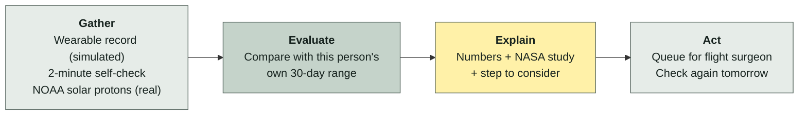
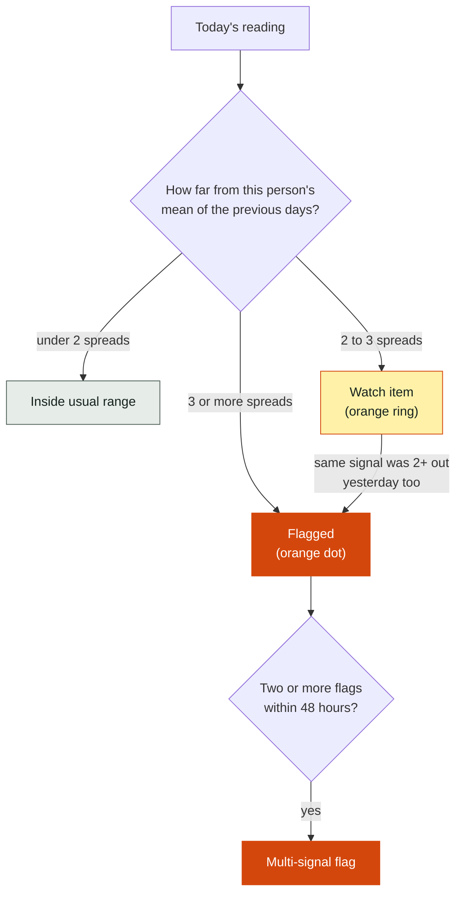

> Prescreening prototype – concept demo

# Baseline

**Baseline is a phone app that tells an astronaut whether today is normal *for them*.** It compares each day's readings with that person's own 30-day range. When something drifts, it shows the numbers, the NASA study behind the change, and one step to consider. It never diagnoses.

<p align="center">
  
  &nbsp;
  
  &nbsp;
  
</p>

> **Every vital sign in this repository is simulated.** There is no real crew data. The demo page says "Simulated data" on every screen. The only real feed is NOAA's solar-proton reading, shown in its own box.

**Status:** prototype built 30 September to 10 October 2026, before the hackathon. The hackathon build starts 14 November 2026, 9:00 a.m. local time, and will be committed from that date. Commit dates separate the two.

---

## How it works



Three ideas carry the whole app:

1. **Your own normal, not a textbook number.** Reaction time of 379 ms is fine for some people. For a person whose usual is 281 ± 16 ms, it is six spreads out. Baseline only knows the second kind of fact.
2. **A study behind every flag.** Each flag links to an NTRS report or OSDR study. No source, no card.
3. **One step, no diagnosis.** The step is a scheduled NASA protocol action (sleep window, ARED session) or "report to the flight surgeon". Nothing more.

---

## Run it in two minutes

You need Python 3.11 or newer. Nothing else. Install once online, then everything runs with wifi off.

Clone or download this repository, open a terminal in its folder and run the lines one at a time.

**Windows (PowerShell)**

```powershell
python -m venv .venv
.venv\Scripts\activate
pip install -e ".[dev]"
pytest -q
python -m baseline.serve
```

If the second line answers "running scripts is disabled on this system", run `Set-ExecutionPolicy -Scope CurrentUser RemoteSigned` once and run the line again.

**Mac / Linux**

```bash
python3 -m venv .venv
source .venv/bin/activate
pip install -e ".[dev]"
pytest -q
python -m baseline.serve
```

`pytest -q` should print **39 passed**. The last line opens the demo in your browser at http://localhost:8000 (or 8001–8010 if busy). Ctrl+C stops it.

**On a phone:** `python -m baseline.serve --lan`, then open the second address it prints on a phone on the same wifi. Windows may ask to let Python through the firewall; allow it for private networks.

**Fully offline:** `OFFLINE=1 python -m baseline.serve` (PowerShell: `$env:OFFLINE = "1"; python -m baseline.serve`). The page never calls any host but localhost anyway. The flag also stops the fetch scripts in `scripts/`, so nothing can reach the network by accident.

<details>
<summary>More run details</summary>

- `python -m baseline.demo` prints the flags for both fixtures in the terminal, then "clean fixture: 2 watch items, 0 confirmed flags" and those two watch items.
- With `make`: `make install`, `make test`, `make demo`, `make serve`.
- The page loads files only from `web/` (fonts, Chart.js, rules, fixture, radiation summary). A Content-Security-Policy blocks every other host.
- The server sends `Cache-Control: no-store`, so a reload always gets the latest files.
- "Start the demo again" resets in memory without reloading, so a phone that has loaded the page once can run it again with no network.
- If `pip install` fails, check that `python --version` shows 3.11 or later.

</details>

---

## The 90-second demo

For a repeatable demo, use the **"Use recorded day-29 self-check"** button in step 1. It loads the simulated record's day-29 reaction time (338 ms), so the flag fires every time.

| Step | Screen | What you see |
|---|---|---|
| 1 | **Self-check** | A guide card, then a 5-round reaction test, sleep hours, sleep quality, mood, and a near-vision line. About 2 minutes. |
| 2 | **Console** | 30-day chart of heart rate variability, sleep and reaction time. Grey band = your usual range. Orange dot = flagged. Orange ring = being watched. |
| 3 | **What changed** | Each flag in two lines: today's value against your usual, then a plain status such as "Well outside your usual range, third day running." |
| 4 | **Evidence card** | The change in plain words, the numbers, why it matters (study finding in bold, source linked), and one step to consider. |
| 5 | **Queue for flight surgeon** | The summary, and "Earliest reply in 44 minutes (22 minutes each way at Mars distance)." Display only. Nothing is sent. |
| 6 | **Next day** | Day 30: each of yesterday's flags compared with today. "Start the demo again" returns to step 1. |

<p align="center">
  
  
  
  
</p>

Wifi stays off for the whole demo.

---

## How a reading gets flagged



- The baseline is the mean and standard deviation of the person's previous days, up to 30. Today is never part of its own baseline.
- No flag can fire before day 15, so every baseline has at least 14 days behind it.
- Only the direction that matters counts: low HRV, slow reaction time, short sleep.
- The Python in `src/baseline/compute` is the reference. `web/rules.js` is a small port of it for the page, and `tests/test_web.py` checks both give the same flags.

**False alarms on pure noise.** We ran the rules on 50 clean 30-day records (seeds 1–50). They raise **0.64** confirmed flags per record on average, and about 3.1 watch items. 26 of the 50 records have no confirmed flag at all.

---

## What is real, what is simulated

| | Source | Status |
|---|---|---|
| **Real** | NOAA GOES solar-proton flux, 7 days, cached 30 Sep 2026 | Shown on the console in its own white box. A rule raises a solar particle event flag at NOAA's S1 level (≥ 10 pfu at ≥ 10 MeV), with tests. |
| **Real** | NASA MSL RAD Mars surface radiation, 30 days to 20 Oct 2026, cached 22 Oct 2026 | Shown in the same box as a daily value in µGy per day. A rule flags a day more than 2 SD above the earlier days, with tests. |
| **Real** | NASA OSDR search results, 10 keywords, cached 30 Sep and 10 Oct 2026 | Source of the OSD-140 study on two cards. |
| **Real** | NASA NTRS search results, 11 keywords, cached 3 Oct and 10 Oct 2026 | Source of the NTRS reports on the cards. |
| **Real** | Your answers in the self-check | Replace day 29's reaction time, sleep and mood. Stay in your browser; gone on reload. |
| **Simulated** | 30 days of vitals for one crew member: heart rate, HRV, SpO2, core temperature, sleep, exercise minutes, reaction time, mood | Gaussian noise around fixed means, seed 7, in `data/fixtures`. The anomaly fixture lowers HRV, sleep and mood and slows reaction time on days 27–29. |

Card text is fixed wording filled in with the rule output.

---

## Evidence behind each card

Every rule has a countermeasure step, and a test checks this. Nothing counts as evidence until the research lead has read the source and copied it in by hand.

| Rule | Study | Step source |
|---|---|---|
| Heart rate variability low | [NTRS 20040087874](https://ntrs.nasa.gov/citations/20040087874) | [NTRS 20140002864](https://ntrs.nasa.gov/citations/20140002864) (ARED or T2 session) |
| Heart rate high | [NTRS 20040087874](https://ntrs.nasa.gov/citations/20040087874) | to be confirmed |
| Sleep short | [NTRS 20240002094](https://ntrs.nasa.gov/citations/20240002094) | [NTRS 20190002002](https://ntrs.nasa.gov/citations/20190002002) (sleep space) |
| Reaction time slow | [NTRS 20240012108](https://ntrs.nasa.gov/citations/20240012108) | [NTRS 20240002094](https://ntrs.nasa.gov/citations/20240002094), [NTRS 20140012988](https://ntrs.nasa.gov/citations/20140012988) (sleep window, lighting) |
| Mood low | [OSD-140](https://osdr.nasa.gov/bio/repo/data/studies/OSD-140) (ground isolation study) | to be confirmed |
| Two signals in 48 h | [OSD-140](https://osdr.nasa.gov/bio/repo/data/studies/OSD-140) | [NTRS 20140002864](https://ntrs.nasa.gov/citations/20140002864) |
| SpO2 low | none yet | to be confirmed |
| Core temperature high | none yet | to be confirmed |

**Not yet reviewed by the research lead** (matches `docs/evidence_map.json`):

- Three sources added 10 Oct 2026: OSD-140 (mood and 48-hour cards), NTRS 20140002864 (ARED/T2 step), NTRS 20140012988 (second source of the reaction-time step).
- Four steps with source "to be confirmed": mood, heart rate, SpO2, core temperature. NTRS 20130011053 was checked for the mood step and covers autogenic-feedback training, not this step. No pulse-oximetry or core-temperature study is in the cached searches.

<details>
<summary>How the evidence map is structured</summary>

Each entry in `docs/evidence_map.json` is keyed by rule id, for example `reaction_above_personal_baseline`. It has `source_type` (`osdr` or `ntrs`), `source_id`, `title` and `url`, and optionally `plain_words`, `key_finding`, `countermeasure` and `countermeasure_source`. `key_finding` is the phrase the card shows in bold; it must appear word for word in `plain_words`, and a test checks this. A study without an id and URL is not shown, and neither is a step without a source line. After editing the map, copy it to `web/data/evidence_map.json`; a test fails if the two differ.

The seven OSDR searches cached on 30 Sep returned 57 hits, 50 distinct studies. Twelve list Homo sapiens; five of those are from human crew (OSD-316, OSD-575, OSD-656, OSD-903, OSD-943). The rest are mouse, rat, fly or cell studies.

</details>

---

## Data sources

| Source | Agency | Used for | Status |
|---|---|---|---|
| [OSDR / GeneLab](https://osdr.nasa.gov) | NASA | Study behind a flag | Searches cached; OSD-140 on two cards, review pending |
| [NTRS](https://ntrs.nasa.gov) | NASA | Reference numbers, countermeasure protocols | Searches cached; four reports reviewed and cited |
| [GOES proton flux](https://services.swpc.noaa.gov/json/goes/primary/integral-protons-7-day.json) | NOAA | Solar particle event alert | Cached; rule and tests done; latest reading on the console |
| [MSL RAD (Curiosity rover)](https://cdaweb.gsfc.nasa.gov/misc/NotesM.html#MSL_RAD_OBS-L2) | NASA (SPDF CDAWeb dataset MSL_RAD_OBS-L2, DOI 10.48322/20qb-4e17; archive: PDS PPI MSL-M-RAD-3-RDR-V1.0) | Real Mars surface radiation level, µGy per day | Cached 30 days; daily values and a 2-SD rule with tests; latest value on the console |
| Vitals telemetry | ours, simulated | All daily readings | Built; clean and anomaly fixtures |

---

## Repository layout

```
src/baseline/compute/   rules, baselines, radiation, wording check  (the reference logic)
src/baseline/serve.py   local web server, --lan for phones
web/                    the page: index.html, app.js, rules.js, screenshots, fonts, Chart.js
data/fixtures/          simulated 30-day records (clean, anomaly)
cache/                  NTRS, OSDR and NOAA responses with source URL and fetch time
docs/                   evidence map, evidence notes, design notes
tests/                  45 tests
```

---

## Challenge and team

[Create Health Monitoring Software for Astronauts on Space Missions](https://www.spaceappschallenge.org/2026/challenges/create-health-monitoring-software-for-astronauts-on-space-missions/), NASA Space Apps Challenge 2026.

Team **Obsidian Prime**, Bangladesh.

## License

Apache-2.0. See [LICENSE](LICENSE).

Third-party files in `web/`: Chart.js 4.5.1 (MIT, `web/vendor/chart.umd.js`, licence header kept) and Source Sans 3 by Adobe (SIL Open Font License 1.1, `web/fonts/OFL.txt`).
