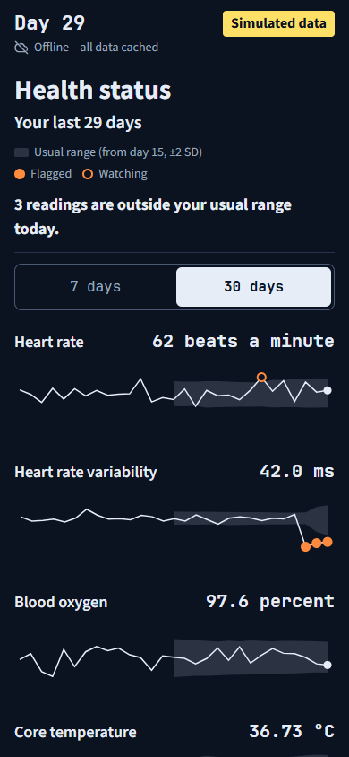
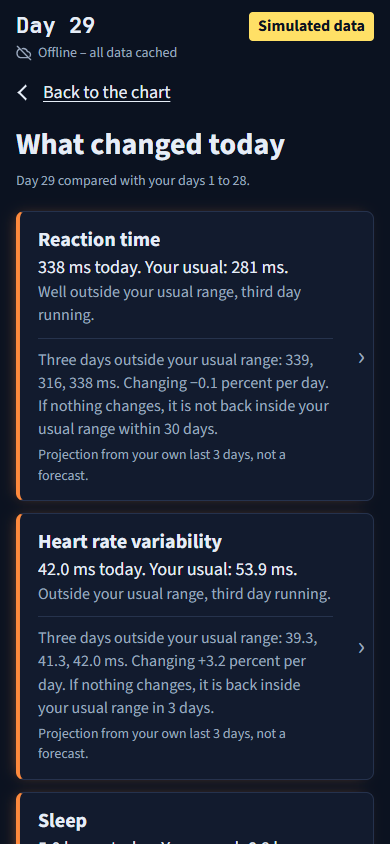
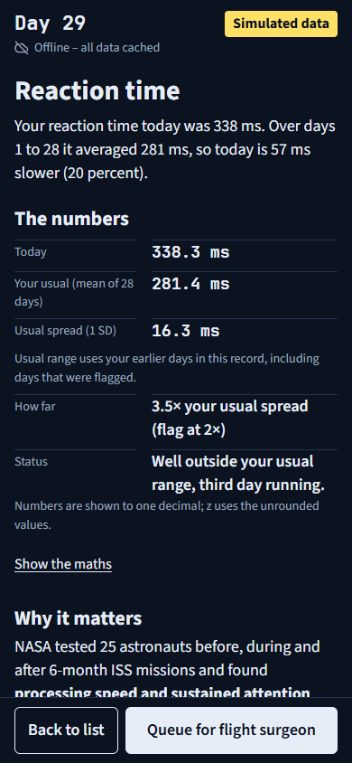
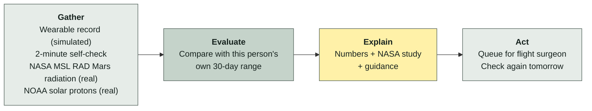
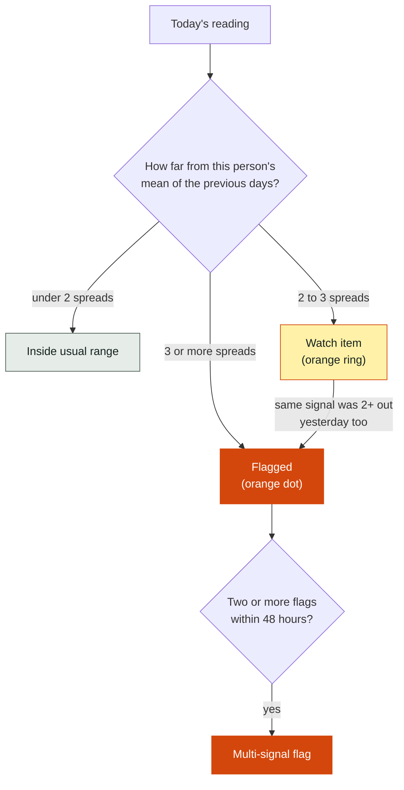

# Baseline

A working offline web app on the phone and the laptop.

**Try it in a browser:** https://obsidianprimeofficial-alt.github.io/baseline/

Baseline tells an astronaut whether today is normal *for them*. It compares each day's readings with that person's own range from the previous days, up to 30. When a reading moves outside that range, it shows the numbers, the NASA study behind the change, and one step to take. It never diagnoses.

<p align="center">
  
  &nbsp;
  
  &nbsp;
  
</p>

> **The vital signs are simulated**, and every screen says so. Three sources are real: NASA MSL RAD Mars surface radiation (29 days, 11 Oct to 8 Nov 2026) and NOAA GOES solar protons (cached 10 Nov 2026). The third is the Skylab 4 crew sleep estimates from a NASA report, shown by role only.

**Built before the event.** The prescreening prototype was built from 30 September to 10 October 2026, and the rest from 22 October 2026. Every step is in the commit history. On 2 November 2026 the Local Lead confirmed in writing that preparing before the event is fine.

## How it works



## How a reading gets flagged



- **Your own normal.** The baseline is the mean and spread of the person's previous days, up to 30. Today never counts in its own baseline, and no flag fires before day 15.
- **Watch or flag.** A reading 2 to 3 spreads from normal is a watch item. At 3 or more spreads, or 2 or more on two days running, it is flagged. Two flags within 48 hours raise a multi-signal flag.
- **A NASA source on every flag.** Each of the 8 rules cites a NASA study, and its step comes from a NASA source ([docs/EVIDENCE.md](docs/EVIDENCE.md)). No source, no card.

Example from the demo: this person's usual reaction time is 281.4 ± 16.3 ms. Today's 338.3 ms is 3.5 spreads slower, so it is flagged.

The rules are plain Python in `src/baseline/compute`. The page runs a JavaScript copy, and the tests check that both give the same flags. On 200 simulated clean 30-day records, the rules raise **0.62** false flags per record. They catch a 4-SD shift in at least **97%** of records ([docs/VALIDATION.md](docs/VALIDATION.md)).

## The demo

On the first screen, tap **"Use recorded day-29 self-check"** so the reaction flag fires every time.

| Step | Screen | What you see |
|---|---|---|
| 1 | Self-check | A 5-round reaction test, sleep hours, sleep quality, mood and a near-vision line. About 2 minutes. |
| 2 | Health status | Seven charts against your usual range, over 7 or 30 days. |
| 3 | What changed | Each flag with today's value against your usual, and a trend card for a reading out three days running. |
| 4 | Evidence card | The NASA study and how strong it is, one step, "Mark step done" and "Show the maths". |
| 5 | Flight surgeon queue | A reply can come up to 40 minutes later: up to 20 minutes each way at Mars distance. Nothing is sent. |
| 6 | Next day | Day 30 shows whether each flagged reading came back. |

Also on the console:
- **Flight surgeon view** (`#crew`): three crew on one screen, each against their own normal.
- **Two replays of real events:** the solar storm of 9 September 2024 (34 pfu, NOAA) and the Mars radiation surge of 20 May 2024 (1,881.0 µGy per day against a usual 161.0, NASA MSL RAD).
- **Real crew record:** the Skylab 4 sleep estimates run through the same sleep rule.
- **Mission-phase risks** under NASA's five hazards, and a **Data sources** panel.

## Run it

You need Python 3.11 or newer. Install once with internet. After that it runs with wifi off.

```bash
python -m venv .venv
.venv\Scripts\activate          # Mac/Linux: source .venv/bin/activate
pip install -e ".[dev]"
pytest -q                        # 204 passed
python -m baseline.serve         # opens http://localhost:8000
```

The tests need Node. Without it, pytest skips the tests that run the page's own scripts. A machine that cannot bind IPv6 loopback prints 203 passed, 1 skipped.

**On a phone:** run `python -m baseline.serve --lan`, then open the second address it prints on a phone on the same wifi.

The same page fills a tablet (700 to 1099 px wide: charts two per row, the self-check in two columns) and a laptop (1100 px and wider: charts three per row, the evidence card in two columns). Under 700 px it is the phone layout. Every device shows the same screens, words and numbers.

## Data sources

The console's "Data sources" panel shows this table word for word (a test checks it).

| Source | Agency | Used for | Real or simulated | Id or link |
|---|---|---|---|---|
| OSDR / GeneLab | NASA | Study id and URL behind every flag | Real | [osdr.nasa.gov](https://osdr.nasa.gov) (REST, no key) |
| NASA Technical Reports Server (NTRS), Human Research Program reports | NASA | Reference numbers, countermeasure protocols | Real | [ntrs.nasa.gov](https://ntrs.nasa.gov) |
| NASA-STD-3001 Vol 1 Rev C | NASA | Guidance source [V1 3004] for the heart rate, blood oxygen, core temperature, mood and 48-hour steps | Real | [NASA-STD-3001 Vol 1 Rev C (PDF)](https://standards.nasa.gov/sites/default/files/standards/NASA/C//nasa-std-3001-vol-1-rev-c-signature.pdf) |
| NASA OCHMO-TB-016 Rev B | NASA | Guidance source for the mood step | Real | [OCHMO-TB-016 (PDF)](https://www.nasa.gov/wp-content/uploads/2023/12/ochmo-tb-016-behavioral-health.pdf) |
| MSL RAD (Curiosity rover) | NASA (SPDF CDAWeb; archived at PDS PPI) | Real Mars surface radiation level for the radiation indicator | Real | [CDAWeb MSL_RAD_OBS-L2](https://cdaweb.gsfc.nasa.gov/misc/NotesM.html#MSL_RAD_OBS-L2), [PDS MSL-M-RAD-3-RDR-V1.0](https://pds-ppi.igpp.ucla.edu/data/MSL-M-RAD-3-RDR-V1.0/), [DOI 10.48322/20qb-4e17](https://doi.org/10.48322/20qb-4e17) |
| GOES proton flux | NOAA | Solar particle event alert | Real | [SWPC 7-day integral protons](https://services.swpc.noaa.gov/json/goes/primary/integral-protons-7-day.json) |
| NOAA SWPC Solar Radiation Storm page | NOAA | S1 level for the solar storm alert: 10 pfu or more at 10 MeV or more | Real | [swpc.noaa.gov solar radiation storm](https://www.swpc.noaa.gov/phenomena/solar-radiation-storm) |
| NASA-STD-3001 Vol 2 Rev C | NASA | Source [V2 6100] for alerting the crew in the solar storm alert | Real | [NASA-STD-3001 Vol 2 Rev C (PDF)](https://www.nasa.gov/wp-content/uploads/2020/10/2022-04-08_nasa-std-3001_vol_2_rev_c_final.pdf) |
| NASA OCHMO-TB-020 Rev E | NASA | Source for the step "Go to the storm shelter." | Real | [OCHMO-TB-020 (PDF)](https://www.nasa.gov/wp-content/uploads/2023/03/radiation-protection-technical-brief-ochmo.pdf) |
| Solar proton event list, 9 Sep 2024 | NOAA (Australian Bureau of Meteorology as second report) | Solar storm replay | Real | [NCEI proton events](https://www.ngdc.noaa.gov/stp/space-weather/interplanetary-data/solar-proton-events/SEP%20page%20code.html), SWPC event list SPE.txt (line 383), [BoM alert](https://listserver.ips.gov.au/pipermail/ips-proton-alert/2024-September/000530.html) |
| Mars radiation surge, 20 May 2024 | NASA (SPDF CDAWeb; MSL RAD team; Solar Physics paper) | Mars surge replay | Real | [CDAWeb MSL_RAD_OBS-L2](https://cdaweb.gsfc.nasa.gov/misc/NotesM.html#MSL_RAD_OBS-L2), [NASA article](https://www.nasa.gov/solar-system/planets/mars/nasa-watches-mars-light-up-during-epic-solar-storm/), [MSL RAD team slides p.17](https://wrmiss.org/workshops/twentyseventh/Hassler.pdf), [DOI 10.1007/s11207-025-02482-4](https://doi.org/10.1007/s11207-025-02482-4) |
| Skylab 4 crew sleep estimates (Experiment M133 final report) | NASA | Real crew record: each crewman's own morning estimate of total sleep, 84 nights, through the sleep rule | Real (crew log estimate) | [NASA CR-141886, NTRS 19750019675](https://ntrs.nasa.gov/citations/19750019675), Tables VIII–X |
| Vitals telemetry | ours, simulated | Daily heart rate, HRV, SpO2, core temperature, sleep, exercise minutes, reaction time, mood | Simulated | `data/fixtures` |

Not covered: blood pressure and blood sugar. The challenge statement names both, but only simulated values would be possible, so they were left out when the scope was set on 28 Oct 2026.

## Use of AI

Following the local organisers' prescreening rule, AI use was not named in this repository before the final submission. It is disclosed in full here. Every tool, in order, is in [docs/AI_USE.md](docs/AI_USE.md).

- **Claude** (Anthropic; Claude Opus 4.8, Claude Opus 5.5): research, the project plan, code review and inspirations of screen designs.
- **NotebookLM** (Google): questions about the Participants Guide.
- **Qwen3-4B**, run once on the team's laptop, wrote an optional one-line explanation for 9 evidence cards. A person read the lines, found one not true, and the feature was removed on 11 Nov 2026. Nothing it wrote is in the app.

**No language model runs in the app.** The flags come from fixed rules with tests. Every line on screen passes a wording check with 76 blocked terms (`src/baseline/compute/wording.py`).

## More

[docs/EVIDENCE.md](docs/EVIDENCE.md) (sources for each rule) · [docs/VALIDATION.md](docs/VALIDATION.md) · [docs/USABILITY.md](docs/USABILITY.md) · [docs/REFERENCES.md](docs/REFERENCES.md)

## Challenge and team

[Create Health Monitoring Software for Astronauts on Space Missions](https://www.spaceappschallenge.org/2026/challenges/health-monitoring-software/), NASA Space Apps Challenge 2026.

Team **Obsidian Prime**, Bangladesh, listed by role: development, design and research; team owner and coordination; submission and eligibility checks; videos (script, recording, editing and subtitles).

## License

Apache-2.0. See [LICENSE](LICENSE). Third-party files in `web/`: Chart.js 4.5.1 (MIT, `web/vendor/chart.umd.js`, licence header kept), Source Sans 3 by Adobe (SIL Open Font License 1.1, `web/fonts/OFL.txt`) and JetBrains Mono 2.304 by JetBrains (SIL Open Font License 1.1, `web/fonts/OFL-jb-mono.txt`).
