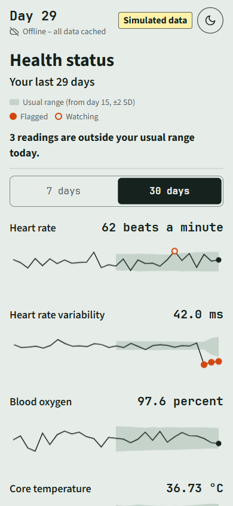
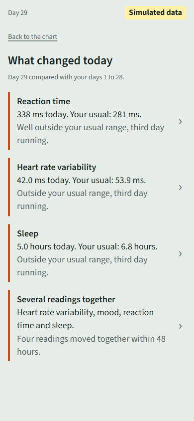
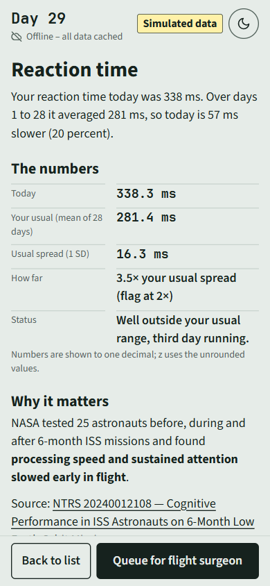
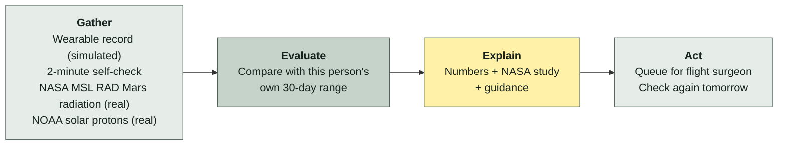
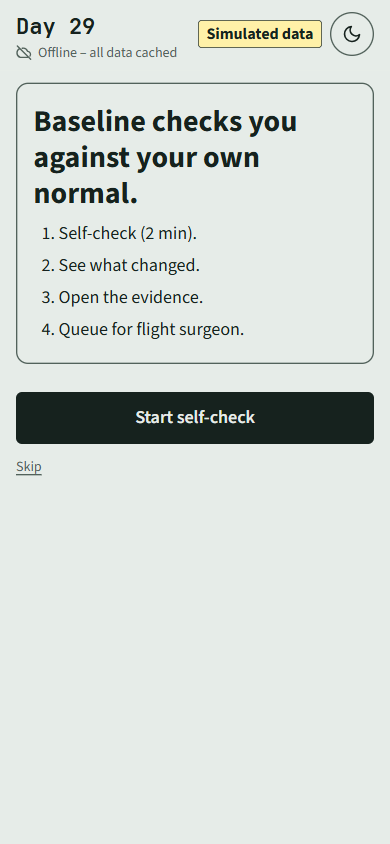
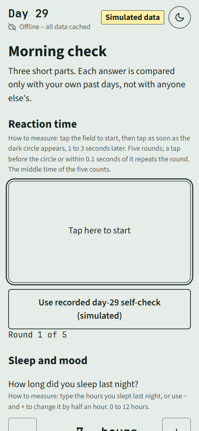
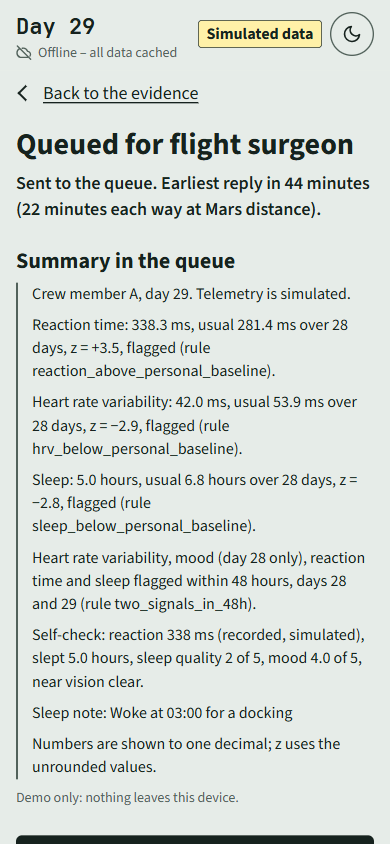
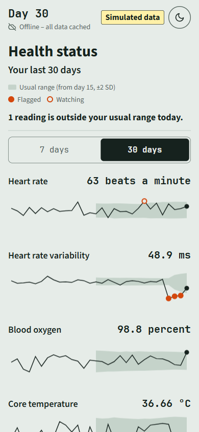
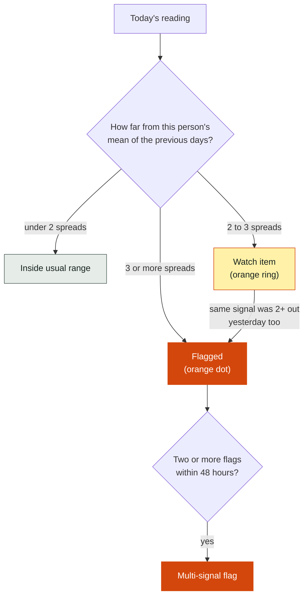

> A working offline web app on the phone and the laptop.

# Baseline

**Baseline is a phone app that tells an astronaut whether today is normal *for them*.** It compares each day's readings with that person's own 30-day range. When something drifts, it shows the numbers, the NASA study behind the change, and one step to consider. It never diagnoses.

<p align="center">
  
  &nbsp;
  
  &nbsp;
  
</p>

> **Every vital sign in this repository is simulated.** There is no real crew data. The demo page says "Simulated data" on every screen. The real feeds are NASA MSL RAD (Mars surface radiation, CDAWeb dataset MSL_RAD_OBS-L2) and NOAA GOES solar protons, shown together in their own box, "Real data: NASA MSL RAD and NOAA GOES".

**Status:** a prescreening prototype was built 30 September to 10 October 2026, and development continued from 22 October 2026; the commit history shows each step. The Bangladesh hackathon runs 13–14 November 2026.

---

## How it works



Three ideas carry the whole app:

1. **Your own normal, not a textbook number.** Reaction time of 338.3 ms is fine for some people. For a person whose usual is 281.4 ± 16.3 ms, it is 3.5 spreads out (the demo's day-29 reaction card). Baseline only knows the second kind of fact.
2. **A study behind every flag.** Each flag links to an NTRS report or OSDR study. No source, no card.
3. **One step, no diagnosis.** The step is a scheduled NASA protocol action (sleep window, ARED session) or "report to the flight surgeon". Nothing more.

---

## Run it in two minutes

You need Python 3.11 or newer. Nothing else. Install once online, then everything runs with wifi off.

Clone or download this repository, open a terminal in its folder and run the lines one at a time.

**Windows (PowerShell)**

```powershell
python -m venv .venv
.venv\Scripts\activate
pip install -e ".[dev]"
pytest -q
python -m baseline.serve
```

If the second line answers "running scripts is disabled on this system", run `Set-ExecutionPolicy -Scope CurrentUser RemoteSigned` once and run the line again.

**Mac / Linux**

```bash
python3 -m venv .venv
source .venv/bin/activate
pip install -e ".[dev]"
pytest -q
python -m baseline.serve
```

`pytest -q` should print **86 passed**. The last line opens the demo in your browser at http://localhost:8000 (or 8001–8010 if busy). Ctrl+C stops it.

**On a phone:** `python -m baseline.serve --lan`, then open the second address it prints on a phone on the same wifi. Windows may ask to let Python through the firewall; allow it for private networks.

**Fully offline:** `OFFLINE=1 python -m baseline.serve` (PowerShell: `$env:OFFLINE = "1"; python -m baseline.serve`). The page never calls any host but localhost anyway. The flag also stops the fetch scripts in `scripts/`, so nothing can reach the network by accident.

<details>
<summary>More run details</summary>

- `python -m baseline.demo` prints the flags for both fixtures in the terminal, then "clean fixture: 2 watch items, 0 confirmed flags" and those two watch items.
- With `make`: `make install`, `make test`, `make demo`, `make serve`.
- The page loads files only from `web/` (fonts, Chart.js, rules, fixture, radiation summary). A Content-Security-Policy blocks every other host.
- The server sends `Cache-Control: no-store`, so a reload always gets the latest files.
- "Start the demo again" resets in memory without reloading, so a phone that has loaded the page once can run it again with no network.
- The round button in the header switches between a light and a dark theme, and the device remembers the choice. With no saved choice the page is dark from 22:00 to 06:00 on the device clock and light otherwise. That window is a simulated crew schedule (`web/theme.js`), not a NASA figure. Screenshots ending in `-dark` show the dark theme.
- If `pip install` fails, check that `python --version` shows 3.11 or later.

</details>

---

## The 90-second demo

For a repeatable demo, use the **"Use recorded day-29 self-check"** button in step 1. It loads the simulated record's day-29 reaction time (338 ms), so the flag fires every time.

| Step | Screen | What you see |
|---|---|---|
| 1 | **Self-check** | A guide card, then a 5-round reaction test, sleep hours, sleep quality, mood, and a near-vision line. About 2 minutes. |
| 2 | **Console** | "Health status": one chart per signal, seven in all (heart rate, heart rate variability (HRV), blood oxygen, core temperature, sleep, mood and reaction time); a 7 days · 30 days switch (30 by default, same usual range in both). Grey band = your usual range. Orange dot = flagged. Orange ring = being watched. |
| 3 | **What changed** | Each flag in two lines: today's value against your usual, then a plain status such as "Well outside your usual range, third day running." A signal outside its usual range three days running also gets a trend card under its flag: the three values, the change per day from a least-squares line through them, and whether a straight line from today gets back inside the usual range within 30 days, labelled "Projection from your own last 3 days, not a forecast." |
| 4 | **Evidence card** | The change in plain words, the numbers, why it matters (study finding in bold, source linked), and "Guidance": one step. "Show the maths" opens a histogram of the days the rule used (28 on day 29), today's line, the usual ± 2 SD lines and the sum in words, e.g. "Today is (338.3 − 281.4) ÷ 16.3 = 3.5 spreads above your usual." |
| 5 | **Queue for flight surgeon** | The summary, and "Earliest reply in 44 minutes (22 minutes each way at Mars distance)." Display only. Nothing is sent. |
| 6 | **Next day** | Day 30: each of yesterday's flags compared with today. "Start the demo again" returns to step 1. |

<p align="center">
  
  
  
  
</p>

Wifi stays off for the whole demo.

---

## How a reading gets flagged



- The baseline is the mean and standard deviation of the person's previous days, up to 30. Today is never part of its own baseline.
- No flag can fire before day 15, so every baseline has at least 14 days behind it.
- Only the direction that matters counts: low HRV, slow reaction time, short sleep.
- The Python in `src/baseline/compute` is the reference. `web/rules.js` is a small port of it for the page, and `tests/test_web.py` checks both give the same flags.

**False alarms on pure noise.** In the validation run (200 clean 30-day records, seeds 1000–1199) the rules raise **0.62** confirmed flags per record on average, and 2.99 watch items. 56% of the records have no confirmed flag at all ([docs/VALIDATION.md](docs/VALIDATION.md)).

---

## What is real, what is simulated

| | Source | Status |
|---|---|---|
| **Real** | NOAA GOES solar-proton flux, 7 days, cached 30 Sep 2026 | Shown on the console in its own box. A rule raises a solar particle event flag at NOAA's S1 level (≥ 10 pfu at ≥ 10 MeV), with tests. At or above S1 the page opens a full-screen alert, "Shelter now", with the step "Go to the storm shelter." and its sources (NASA OCHMO-TB-020 Rev E; NASA-STD-3001 Vol 2 Rev C [V2 6100]; NOAA SWPC), and says when the reading was cached. The 30 Sep reading is below S1, so no alert opens. |
| **Real** | NOAA's listed values for the solar proton event of 9 Sep 2024 (start 16:40 UTC, maximum 34 pfu at 22:50 UTC, S1), from the SWPC event list and the NCEI proton event list, also reported by the Australian Bureau of Meteorology; cached 30 Oct 2026 in `cache/noaa/spe-2024-09-09.json` | "Replay a real solar storm: 9 September 2024" on the console plays the three points and opens the alert at the S1 crossing, labelled as a replay, not today's data. No curve. |
| **Real** | NASA MSL RAD Mars surface radiation, 30 days to 20 Oct 2026, cached 22 Oct 2026 | Shown in the same box as the latest day in µGy per day. A rule with tests compares that day with the earlier days, and the box says whether it is within or above their usual range (mean ± 2 SD). No flag row or step yet. |
| **Real** | NASA OSDR search results, 10 keywords, cached 30 Sep and 10 Oct 2026 | Source of the OSD-140 study on two cards. |
| **Real** | NASA NTRS search results, 11 keywords, cached 3 Oct and 10 Oct 2026 | Source of the NTRS reports on the cards. |
| **Real** | Your answers in the self-check | Replace day 29's reaction time, sleep and mood. Each saved check is kept in this browser on this device (no cloud, no network) and is still there after a reload; "Download the daily log (CSV)" exports it and "Clear saved days" removes it. |
| **Simulated** | 30 days of vitals for one crew member: heart rate, HRV, SpO2, core temperature, sleep, exercise minutes, reaction time, mood | Gaussian noise around fixed means, seed 7, in `data/fixtures`. The anomaly fixture lowers HRV, sleep and mood and slows reaction time on days 27–29. |

Not covered: blood pressure and blood sugar. The challenge statement names both, but only simulated values would be possible, so they were left out when the scope was set on 28 Oct 2026.

Card text is fixed wording filled in with the rule output.

---

## Evidence behind each card

Every rule cites a NASA study and a NASA source for its step, and a test checks that every rule has a step. All sources were reviewed on 24 Oct 2026; what each one is, and how strong, is in [docs/EVIDENCE.md](docs/EVIDENCE.md).

The rules are validated on simulated data: a 4-SD shift is caught in at least 97% of fixtures, with 0.62 confirmed false flags per clean 30-day record (the same run: n=200, seeds 1000–1199). How this was measured, with the result tables, is in [docs/VALIDATION.md](docs/VALIDATION.md).

| Rule | Study | Step source |
|---|---|---|
| Heart rate variability low | [NTRS 20040087874](https://ntrs.nasa.gov/citations/20040087874) (4 crew, 16-day flight) | [NTRS 20140002864](https://ntrs.nasa.gov/citations/20140002864) (ARED or T2 session; conference abstract) |
| Heart rate high | [NTRS 20040087874](https://ntrs.nasa.gov/citations/20040087874) | [NASA-STD-3001 Vol 1 Rev C [V1 3004]](https://standards.nasa.gov/sites/default/files/standards/NASA/C//nasa-std-3001-vol-1-rev-c-signature.pdf) (repeat at rest, report) |
| Sleep short | [NTRS 20240002094](https://ntrs.nasa.gov/citations/20240002094) | [NTRS 20190002002](https://ntrs.nasa.gov/citations/20190002002) (sleep space) |
| Reaction time slow | [NTRS 20240012108](https://ntrs.nasa.gov/citations/20240012108) | [NTRS 20240002094](https://ntrs.nasa.gov/citations/20240002094), [NTRS 20140012988](https://ntrs.nasa.gov/citations/20140012988) (sleep window, lighting; the second is a conference abstract) |
| Mood low | [OSD-140](https://osdr.nasa.gov/bio/repo/data/studies/OSD-140) (ground isolation study (Mars-500), 6 crew, not spaceflight; DOI 10.26030/pybz-6s43) | [OCHMO-TB-016 Rev B](https://www.nasa.gov/wp-content/uploads/2023/12/ochmo-tb-016-behavioral-health.pdf) and [NASA-STD-3001 Vol 1 Rev C [V1 3004]](https://standards.nasa.gov/sites/default/files/standards/NASA/C//nasa-std-3001-vol-1-rev-c-signature.pdf) (private conference or journal, report) |
| Two signals in 48 h | [OSD-140](https://osdr.nasa.gov/bio/repo/data/studies/OSD-140) | [NASA-STD-3001 Vol 1 Rev C [V1 3004]](https://standards.nasa.gov/sites/default/files/standards/NASA/C//nasa-std-3001-vol-1-rev-c-signature.pdf) (send today's summary to the flight surgeon) |
| SpO2 low | [NTRS 20150021491](https://ntrs.nasa.gov/citations/20150021491) (names the risk, no SpO2 readings) | [NASA-STD-3001 Vol 1 Rev C [V1 3004]](https://standards.nasa.gov/sites/default/files/standards/NASA/C//nasa-std-3001-vol-1-rev-c-signature.pdf) (check the sensor, repeat, report) |
| Core temperature high | [NTRS 20000104233](https://ntrs.nasa.gov/citations/20000104233) (2 crew) | [NASA-STD-3001 Vol 1 Rev C [V1 3004]](https://standards.nasa.gov/sites/default/files/standards/NASA/C//nasa-std-3001-vol-1-rev-c-signature.pdf) (repeat later today, report) |

NASA-STD-3001 [V1 3004] requires vital signs to be monitored and trended and private contact with ground medical support. It backs the "report to the flight surgeon" part of a step, not measurement advice such as "at rest" or "check the sensor".

<details>
<summary>How the evidence map is structured</summary>

Each entry in `docs/evidence_map.json` is keyed by rule id, for example `reaction_above_personal_baseline`. It has `source_type` (`osdr` or `ntrs`), `source_id`, `title` and `url`, and optionally `plain_words`, `key_finding`, `countermeasure` and `countermeasure_source`. `key_finding` is the phrase the card shows in bold; it must appear word for word in `plain_words`, and a test checks this. A study without an id and URL is not shown, and neither is a step without a source line. After editing the map, copy it to `web/data/evidence_map.json`; a test fails if the two differ.

The seven OSDR searches cached on 30 Sep returned 57 hits, 50 distinct studies. Twelve list Homo sapiens; five of those are from human crew (OSD-316, OSD-575, OSD-656, OSD-903, OSD-943). The rest are mouse, rat, fly or cell studies.

</details>

---

## Data sources

| Source | Agency | Used for | Status |
|---|---|---|---|
| [OSDR / GeneLab](https://osdr.nasa.gov) | NASA | Study behind a flag | Searches cached; OSD-140 on two cards, reviewed |
| [NTRS](https://ntrs.nasa.gov) | NASA | Reference numbers, countermeasure protocols | Searches cached; eight reports reviewed and cited |
| [GOES proton flux](https://services.swpc.noaa.gov/json/goes/primary/integral-protons-7-day.json) | NOAA | Solar particle event alert | Cached; rule and tests done; latest reading on the console; full-screen alert at S1 |
| [Solar proton event list](https://www.ngdc.noaa.gov/stp/space-weather/interplanetary-data/solar-proton-events/SEP%20page%20code.html) (also the SWPC event list SPE.txt, line 383; [Australian Bureau of Meteorology alert](https://listserver.ips.gov.au/pipermail/ips-proton-alert/2024-September/000530.html)) | NOAA | Solar storm replay, 9 Sep 2024 | Listed values cached; replay on the console |
| [MSL RAD (Curiosity rover)](https://cdaweb.gsfc.nasa.gov/misc/NotesM.html#MSL_RAD_OBS-L2) | NASA (SPDF CDAWeb dataset MSL_RAD_OBS-L2, DOI 10.48322/20qb-4e17; archive: PDS PPI MSL-M-RAD-3-RDR-V1.0) | Real Mars surface radiation level, µGy per day | Cached 30 days; daily values and a 2-SD rule with tests; latest value on the console |
| Vitals telemetry | ours, simulated | All daily readings | Built; clean and anomaly fixtures |

---

## Repository layout

```
src/baseline/compute/   rules, baselines, radiation, trend projection, wording check  (the reference logic)
src/baseline/serve.py   local web server, --lan for phones
web/                    the page: index.html, app.js, rules.js, trend.js, projection.js, maths.js, spe.js, screenshots, fonts, Chart.js
data/fixtures/          simulated 30-day records (clean, anomaly)
cache/                  NTRS, OSDR and NOAA responses with source URL and fetch time
docs/                   evidence map, evidence notes, design notes
tests/                  86 tests
```

---

## Challenge and team

[Create Health Monitoring Software for Astronauts on Space Missions](https://www.spaceappschallenge.org/2026/challenges/health-monitoring-software/), NASA Space Apps Challenge 2026.

Team **Obsidian Prime**, Bangladesh. Each member is listed by role:
- Development, design and research: the app, the rules and tests, the evidence cards and the NASA data.
- Team owner on the NASA Space Apps site and team coordination.
- Submission and eligibility checks.
- Videos: script, recording, editing and subtitles.

## License

Apache-2.0. See [LICENSE](LICENSE).

Third-party files in `web/`: Chart.js 4.5.1 (MIT, `web/vendor/chart.umd.js`, licence header kept), Source Sans 3 by Adobe (SIL Open Font License 1.1, `web/fonts/OFL.txt`) and JetBrains Mono 2.304 by JetBrains (SIL Open Font License 1.1, `web/fonts/OFL-jb-mono.txt`).
